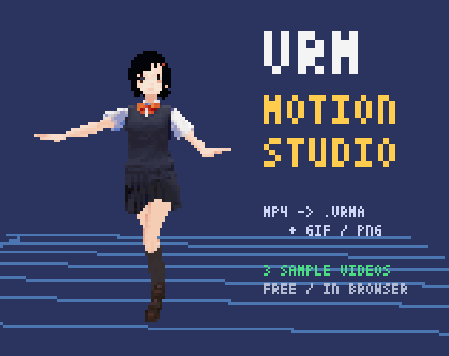

# VRM Motion Studio

[日本語](README.ja.md)

Turn a dance or action video into a VRM animation (`.vrma`), right in the browser, and watch it on a retro Pyxel 3 avatar.
A sister tool of [VRM RETRO VIEWER](https://github.com/harukaappscreate/vrm-retro-viewer), [VRM RETRO MAKER](https://github.com/harukaappscreate/vrm-retro-maker) and [VRM RETRO PAPERCRAFT](https://github.com/harukaappscreate/vrm-retro-papercraft).



- Play on itch.io: https://haruka-apps-games.itch.io/
- Everything runs in your browser. Nothing is installed and no video is sent anywhere.

## What it does

1. Open a `.mp4` (or try Sample 1-3).
2. MediaPipe finds the body in each frame; the pose drives a 52-bone VRM humanoid drawn with Pyxel 3's 3D (`pyxel.cube`).
3. Save the motion as `.vrma` (`VRMC_vrm_animation`) and use it in any VRM app.
4. Drop your own VRM (0.x or 1.0) to see the motion on it.

## Run locally

Serve the folder with any web server and open `index.html`:

```sh
python -m http.server 8000
# then open http://localhost:8000/
```

The Pyxel part is in `game/` (`app.pyxapp` is its packaged copy).

## Files

| File | What |
|---|---|
| `index.html` | The page: video, MediaPipe pose tracking, and the Pyxel view |
| `game/main.py` | The Pyxel 3 app (avatar, retargeting, `.vrma` export) |
| `game/vrm_io.py`, `game/vrm_figure.py` | Reading VRM and posing it |
| `game/vrma_export.py` | Writing `.vrma` |
| `game/model.tmx`, `game/tex_*.png` | The default avatar |
| `sample1-3.mp4` | Short sample videos |

## Credits

- Default avatar: Sendagaya Shibu, a CC0 sample model of VRoid (VRM data by coati)
- Sample videos: generated with AI (Google Gemini) for this tool
- [Pyxel](https://github.com/kitao/pyxel) by Takashi Kitao (MIT License)
- [MediaPipe](https://github.com/google-ai-edge/mediapipe) (Apache-2.0) and [Kalidokit](https://github.com/yeemachine/kalidokit) (MIT), loaded from a CDN

## License

MIT License (haruka_apps). See LICENSE.

You are responsible for following the license of any VRM or video you load.
